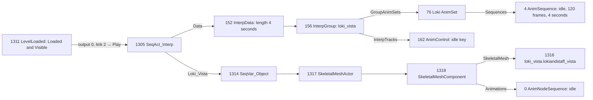

# Loki animation: saved binding and native contracts

This is an evidence increment, separate from the minimal Float96 arithmetic
correction in `ANIMATION.md`. It adds no playback, interpolation, inherited
default, transform or skinning implementation. The owned packages establish a
concrete saved `idle` path. Native disassembly establishes codec dispatch and
parts of initialization; final omitted class defaults remain unresolved.

## Owned sources

All assets and retained output stay under
`~/.local/share/marvel-heroes-forever-rust/`. The first source is the existing
fixed startup pin. Core, Engine and MarvelGame were copied to the separate
`pins/animation-runtime-class-defaults/UnrealEngine3/MarvelGame/CookedPCConsole/`
directory only after their complete candidate-file hashes matched the inventory
and source size/mtime/inode remained stable. The transfer destination was read
only, never changed. Copies were hashed again and made read-only.

| Owned file | Bytes | SHA-256 |
| --- | ---: | --- |
| `MarvelVista_AsgardHub.upk` | 8,475,579 | `2f45ae3e0490c54a9ec37884b463f96690c805b77cc244664719a59fe2754153` |
| `Core.upk` | 51,673 | `5cbe7d50003197d7096efcae9fc2eaf392a6d44458dfe51ed6487266dcf36ccb` |
| `Engine.upk` | 1,491,131 | `66dd5dca80f275a8cc2de5bf4b03042949cfccd0afc0edc6b7ba9b577cde4f51` |
| `MarvelGame.upk` | 5,224,388 | `d9c98071ecbbf5d2b35936fa52283b804c45acccaa16faf232561c796ee9cdc6` |
| `MarvelHeroesOmega.exe` | 48,544,080 | `8b7212d6376c9f86b0180efb34448935b7c6a3e8dee090a8ab24385c23392fc1` |

The executable source is the fully pinned file under
`pins/alienware-candidate/UnrealEngine3/Binaries/Win64/`. Retained REA observations
bind its full hash and report whether it changed. Source pin details are in
private `evidence/animation-runtime/class-package-pins.json`.

## Saved scene graph

**VERIFIED saved bytes:** an independent original reader checked 939 flattened
property records and 205 reference edges across 47 relevant exports, including
12 explicitly asserted Loki edges. Export indices here are zero-based; saved
positive references equal the export index plus one.

**OBSERVED:** the component saves SkeletalMesh, Animations, a null
ReplacementPrimitive and LightingChannels. It has **no saved AnimSets property**.
The AnimSet reference belongs to InterpGroup 156: GroupAnimSets element 0 is
reference 77 at group-export offset 132, logical package offset 1,898,758. Among
the inspected scene objects, this is the sole reference to AnimSet 76.

The group's name is `loki_vista`; the action variable-link description is
`Loki_Vista`. Their connection is saved, while the runtime's name comparison
semantics have not been executed. The LevelLoaded edge is an activation
declaration, not proof of a fired event or running animation.

| Saved location | Observed values |
| --- | --- |
| AnimNodeSequence 0 | AnimSeqName `idle`; CurrentTime approximately 0.0001 seconds; no saved playing/looping/rate values |
| InterpData 152 | InterpLength and EdSectionEnd both 4 seconds |
| AnimControl 162, sole key | StartTime 0; `idle`; start/end offsets 0; play rate 1; looping false; reverse false |
| SeqAct_Interp 1305 | **Action** looping true; no saved top-level PlayRate/rewind/force-start value |

Action looping and animation-key looping are different fields. Their runtime
precedence and the boolean ultimately passed to the codec are not inferred.

**OBSERVED:** PreviewSkelMeshName remains `loki_traveling.loki_traveling`; the
component explicitly references `loki_vista.lokiandstaff_vista`. The preview
name is not the mesh edge in this saved graph. This does not establish that
every native path ignores preview metadata, nor prove live retargeting rules.
No preview asset was fetched.

All 73 vista bone names match 84 animation track names, leaving 11 extra tracks.
UseTranslationBoneNames has 16 entries: 15 match animation tracks and only seven
match vista bones; one entry matches neither. The list is retained as data.
Exact-name correspondence does not authorize applying a translation policy or
assuming compatible reference poses.

Private graph receipt: `scene-binding/graph-receipt.json`, SHA-256
`f4bb9da5826ef2e083e4aac60bea36044cea29f2b2f61a9fa0af3b5afa566394`.
The supporting property/edge records retain export-relative and logical UPK
spans, which are not physical offsets in the compressed file.

## Saved classes and defaults

**VERIFIED saved bytes:** six default objects were independently parsed to exact
EOF, totaling 290 bytes and eight saved fields. Six class payloads are retained
opaque; five enum/property payloads were separately checked.

| Engine default object | Saved fields relevant here |
| --- | --- |
| 6261 `Default__AnimSequence` | RateScale = 1; no saved compression/key format or no-loop-interpolation field |
| 7661 `Default__AnimSet` | bAnimRotationOnly = true |
| 6742 `Default__AnimNodeSequence` | Rate = 1; bSynchronize = true; camera scale/rate = 1; camera blend-in/out approximately 0.2 |
| 6454 `Default__AnimNode` | No saved fields or native tail |
| 6411 `Default__AnimObject` | No saved fields or native tail |
| Core 1 `Default__Object` | No saved fields or native tail |

The AnimSequence and AnimSet class superclass is Core.Object; their default
archetype is Core.Default__Object. AnimNodeSequence's chain is AnimNodeSequence
→ AnimNode → AnimObject → Core.Object, with the corresponding saved default
archetype chain. Engine import -35 resolves Core.Object and -127 resolves
Core.Default__Object in the fixed Core pin.

**OBSERVED:** owned enum arrays identify key encoding ordinals Constant 0,
Variable 1, PerTrack 2; compression ordinals None 0, Float96NoW 1, Fixed48NoW 2,
IntervalFixed32NoW 3, Fixed32NoW 4, Float32NoW 5, Identity 6. Their sentinel
entries are retained separately. KeyEncodingFormat ByteProperty export 6291
ends with reference 6253 to enum export 6252. Rotation and translation byte
properties 6292/6293 end with reference 6334 to enum export 6333.

These owned tags, enum positions and archetype names do **not by themselves**
establish effective omitted values. The decoder still requires explicit caller
values for absent codec properties. Saved defaults are also distinct from a
complete effective scene-instance policy.

Private class/default receipt: `class-defaults-independent/class-defaults-receipt.json`,
SHA-256 `90f691308e032b674ded903ca65a162bacaf9cba17b7bd810aae192436e4ffa6`.

## Native initialization evidence and remaining default gap

**OBSERVED with REA:** bounded disassembly grounds the following stages. Function
roles are attributed from registration, call relationships and owned metadata;
incidental PE export aliases are not used as Unreal function names.

| Address | Established stage |
| --- | --- |
| `0x140d83d00` | AnimSequence class factory passes native instance size `0x154` and constructor callback `0x140d88aa0` |
| `0x14079c980` | Core.Object class factory passes native instance size `0x60` |
| `0x140d88aa0` | Calls base constructor `0x140793fd0`, then installs the AnimSequence vtable; neither writes instance bytes beyond the vtable |
| `0x140745a20` | Default-object resolver; fresh construction call at `0x140745aed` supplies the parent default archetype and flags `0x20400000200` |
| `0x1407a8d20` | Allocation path reaches confirmed `memset(object, 0, class_size)` at `0x1407a9cf8`; a separate reuse path can return before this zeroing |
| `0x1407a5d10`, `0x14079d6d0` | Default initialization and copy; bulk copy starts at instance offset `0x60`, with a supplied/default extent |
| `0x140741410` | Additional conditional class-default finalization after construction; this prevents equating initial zero allocation with final loaded defaults |

An independent native assessment follows the resolver's arguments through the
constructor wrapper and allocator. On this **fresh resolver path**, the supplied
zero context skips an otherwise unbounded special-property copy loop; the second
property loop is extent-gated. This is stronger evidence than tag omission, but
it remains conditional on the relevant class-size, property-layout and loading
contracts. It does not cover arbitrary reuse/loading paths.

The later finalization helper checks global state and class flags. If admitted,
it calls a class virtual function, initializes default data, invokes an optional
callback and reaches further loading operations. Those applicable effects and
the native field/boolean mapping are not fully established here. Therefore final
TranslationCompressionFormat, RotationCompressionFormat, KeyEncodingFormat and
bNoLoopingInterpolation defaults remain **UNKNOWN**, and no replacement of
caller-supplied formats is authorized by this evidence increment.

Private independent assessment and exact remaining gaps are under
`native/defaults-independent/`; retained calls are in
`rea-class-init.json`, `rea-object-construction.json`,
`rea-allocation-and-format.json`, `rea-core-and-default-resolution.json`,
`rea-quaternion-tail-and-default-copy.json` and
`rea-default-postconstruction.json` in the private native evidence directory.

## Native codec selection and timing scope

**OBSERVED with REA:** codec setup at `0x1407d9b10` reads the key-encoding byte at
instance offset `0xfa` and translation/rotation format bytes at `0xf8`/`0xf9`.
Its mode branches are 0, 1 and 2. Saved enum order, diagnostic strings and codec
tables support the field attribution; an omitted saved value is still not
silently supplied to select a branch.

For constant mode / Float96 rotation, the selector initializes a codec object
whose vtable is `0x141e1cfe0`. Variable Float96 uses `0x141e1d248`.
The compressed GetBoneAtom wrapper at `0x1407d9470` loads sequence offset `0x124`
and calls virtual slot `0x10`. Both observed Float96 tables point that slot to
`0x1407e26e0`, which resolves the four saved offset/count words and divides
the supplied time by SequenceLength. Its translation and rotation calls use
virtual slots `0x30` and `0x28` respectively.

| Conditional selected profile | Native key function |
| --- | --- |
| Constant / None translation | `0x1407e8450` |
| Constant / Float96 rotation | `0x1407e27e0` |
| Variable / Float96 rotation | `0x1407e5070` |

The standalone Float96 W order was independently checked in the single-key and
both multi-key reconstructions for constant and variable functions. The resulting
small code correction and six-sequence verification are documented in
`ANIMATION.md`; they do not implement timing or interpolation.

**OBSERVED branch contract, not implemented:** on a cache miss or a compatible
cache hit, the constant translation function
distinguishes channel key count `K`, sequence frame count `N`, normalized time
and a boolean argument. A channel with fewer than two keys selects its first
key. Nonpositive normalized time selects the first keys. With the boolean zero,
time at/after the endpoint selects the final key, while interior positions scale
by `K-1`. With the boolean nonzero, time at/after the endpoint selects the first
keys; the interior path uses `N` and includes a final-frame-to-first-key segment,
with a separate remapping branch when `K != N`. These are decoder boundary cases,
not evidence of an outer animation clock performing modulo wrapping.

The constant rotation path uses the corresponding index/alpha selection. When
two keys differ, it reconstructs both quaternions, compares their dot product,
chooses a sign for the second contribution, blends and normalizes. Normalization
contains `RSQRTSS` and a refinement step; its exact instruction order and fallback
constants must be preserved if later implementing instruction-level behavior.
It is not justified to substitute an arbitrary interpolation library operation.
The codec boolean's connection to the saved action/key flags is still unknown.

Both key readers share a native index/alpha cache keyed by channel key count,
the boolean, duration and normalized time. The observed key omits NumFrames and
sequence identity. A stateless helper cannot yet be claimed equivalent across
different sequences without establishing the relevant caller invariant or
preserving the cache behavior. File-backed constants establish a negative-dot
sign of -1, normalization threshold approximately `1e-8`, coefficient 3 and
identity-quaternion fallback; lazy coefficient and wrapper-initializer storage
have separate runtime-state boundaries retained in the private receipt.
The translation output also uses a packed mask at `0x142c24da0` whose runtime
contents have not been established. Exact lane replacement and preservation
of the fourth lane therefore remain unresolved.

**Separate raw-data path:** `0x140d815a0` dispatches compressed data when the
force-raw argument permits it and the compressed offset count is positive.
The remaining raw-track interpolation body is not evidence for compressed idle
playback. The independent raw-policy receipt preserves this boundary. Some raw
normalization constants lie in the PE virtual data tail without original
file-backed bytes; they were not read from unrelated file offsets or invented
from zero-fill assumptions.

## Transform, skinning and activation limits

Saved skeleton reference poses and decoded animation keys remain in serialized
coordinates. This increment does not establish quaternion/translation matrix
conventions, parent composition order, inverse-bind construction, root-motion
policy, mesh origin/rotation application, CPU/GPU skin matrices, weight treatment,
coordinate conversion or animation retargeting. No native skinning function or
vertex shader was exercised. The existing skeletal reader's palette and weight
decoding is asset evidence, not proof of the final skin transform.

The startup event graph was not executed. Matinee group installation of AnimSets,
animation lookup order, the actual clock, flag precedence, tick scheduling,
blend state and live scene activation still need corresponding native/runtime
evidence. The saved preview mismatch remains explicit even though the actor's
actual mesh reference is now known.

## Evidence handling and provenance

All private paths below are relative to `evidence/animation-runtime/`:

- `validation.json`: finalized source and evidence consistency receipt, SHA-256
  `703cf68c257a77b533e989fafc3ed38650ab18e6dfc0a6c3551b92dd9fb48749`.
- `source-ledger.json`: this increment's exact source paths, hashes and uses.
- `class-package-pins.json`: stable source/hash checks and separate fixed copies.
- `scene-binding/graph-receipt.json` and its source ledger: exact saved graph,
  property/edge spans and independent raw-byte checks.
- `class-defaults-independent/`: exact CDO/enum checks and source ledger.
- `native/`: original PE/string/unwind candidates, REA observations, decoded
  instruction listings and retained Evidence bundles.
- `native/defaults-independent/`, `native/raw-policy-independent/`: conditional
  native conclusions and their explicitly unresolved boundaries.
- `native/constant-policy-independent/`: compressed constant-key branch contract,
  shared-cache limitation, exact constants and bounded instruction checks.
- `w-fix/`: the separately committed arithmetic correction's focused validation.

The final `native/runtime-increment.bundle.json` retains 14 REA observations:
12 completed with exit code zero and two retain unknown completion status.
The independent constant-codec receipt is
`native/constant-policy-independent/constant-policy-receipt.json`, SHA-256
`283c7b4cf88e6f1ca7404dfddebe8b38ebba9e451b9e88e60e96dda9b8badaa0`.

REA 6.9.0 was used through target-free Rizin commands on the hash-pinned owner
binary. Ghidra's session provider remained unavailable because of its Java
configuration; no setup, configuration or shared-target change was made.
Two initial 30-second Rizin calls returned provider timeouts with retained
instruction output. Their observations remain marked partial/unknown completion.
Later new bounded calls used the per-call 120-second budget and completed without
output truncation. No global analysis or string-inventory completeness is claimed.

Original Python/Rust harnesses and a small original SSE arithmetic harness were
used for private checks. The SSE harness executes newly written arithmetic, not
retail code. There was no account, live-server, character-data or Wine-prefix
access. No extracted bytes or reconstructed key values enter git.

Sources studied for this increment are the owner's **proprietary Gazillion
client files** listed above, **REA-retained output** for those files, and the
project's original package/property/skeletal readers. No new outside parser,
VM or game implementation source was read or copied. The earlier UE Viewer
MIT study and its exact pinned source ledger remain documented in `ANIMATION.md`;
native observations supersede that reference where they disagree.
