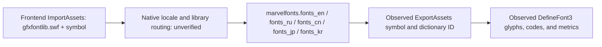

# Actual frontend font resources

**OBSERVED:** The original `MarvelFonts_SF.upk` supplies the requested font
symbols. They occur in its locale-specific SwfMovie exports, rather than in
Startup's `marvelflash.fonts` movie. This establishes the saved symbol-to-glyph
relationships below. The native routing of the logical
`../MarvelFonts/gfxfontlib.swf` import to a locale movie remains unverified.

## Private source pin

The distribution inventory contains exactly one path with `font` in its name:
`UnrealEngine3/MarvelGame/CookedPCConsole/MarvelFonts_SF.upk`.
The source package is 25,533,918 bytes, SHA-256
`43b7f8576a487601e812607e1c18f3ced659629de22b0cf7c7ae97b601adf76e`.

**VERIFIED:** A separate private copy matches that inventory size and hash:
`~/.local/share/marvel-heroes-forever-rust/pins/frontend-fonts/UnrealEngine3/MarvelGame/CookedPCConsole/MarvelFonts_SF.upk`.
It was copied read-only from the existing `alienware-bazzite` alias and the
owner's installed distribution path recorded in `FINDINGS.md`, using SSH
`BatchMode=yes`, `StrictHostKeyChecking=yes`, and `ConnectTimeout=8`.
No Wine prefixes, account files, character data, or generated settings were
accessed. Original install files were read only.

The original package reader reports 114 names, 33 imports, and 42 exports.
The five SwfMovie exports are:

| Zero-based UPK export | Full object path | RawData bytes |
| ---: | --- | ---: |
| 17 | `marvelfonts.fonts_cn` | 14,917,555 |
| 18 | `marvelfonts.fonts_en` | 431,440 |
| 19 | `marvelfonts.fonts_jp` | 5,977,907 |
| 20 | `marvelfonts.fonts_kr` | 5,710,776 |
| 21 | `marvelfonts.fonts_ru` | 514,573 |

All five RawData values are exact byte arrays and begin with uncompressed GFX
version 8. No export or object redirector in this package is named `gfxfontlib`.
The SwfMovie properties contain no serialized References array connecting these
movies to the frontend import; absence of a serialized property does not prove
the corresponding runtime state is absent.

## Exact English font symbol graph

**OBSERVED:** `marvelfonts.fonts_en` contains five DefineFont3 definitions, and
its ExportAssets records associate symbols with those exact dictionary IDs:

| Exported symbol | Font ID | Serialized font name | Glyphs |
| --- | ---: | --- | ---: |
| `$RobotoRegular` | 1 | Roboto | 806 |
| `$RobotoBold` | 2 | Roboto, Bold flag set | 806 |
| `$RobotoMedium` | 3 | Roboto Medium | 806 |
| `$Strat2Medium` | 4 | Stratum2 Medium | 378 |
| `$Strat2Bold` | 5 | Stratum2 Bold | 378 |

The private English movie is
`evidence/frontend-fonts/MarvelFonts_SF-fonts_en.gfx`, SHA-256
`330b919bcbabe8612db9c2140a8f327a663362fd7e1aaa28a215c702cae7032a`.
Its saved outer path and exported symbol names provide real glyph resources for
an explicit English font-library selection. They do not prove that the native
client resolves every logical import to this library under every locale.

**OBSERVED:** `fonts_ru` exports the same five symbols, but `$Strat2Medium`
maps to Cervo Regular and `$Strat2Bold` maps to Cervo Medium, with 458 glyphs
each. Its three Roboto definitions contain 806 glyphs each. Therefore a global
symbol lookup across locale movies is ambiguous.

The other movies export their own symbol pairs:

| Movie | Actual exported symbols |
| --- | --- |
| `fonts_cn` | `$NotoSansTCBold`, `$NotoSansTCMedium` |
| `fonts_jp` | `$NotoSansJapaneseMedium`, `$NotoSansJapaneseBold` |
| `fonts_kr` | `$NotoSansKoreanBold`, `$NotoSansKoreanMedium` |

None of these three exports the Stratum or Roboto symbols requested by the
frontend. Any native remapping between those symbol families needs separate
evidence; no arbitrary substitute is selected here.

## Configuration evidence and remaining runtime edge

**VERIFIED:** All 27 inspected pinned `Base*.ini` and `Default*.ini` files match
their distribution-inventory hashes. Distribution defaults whose names contain
`UserSettings` are included; generated user settings are not.

**OBSERVED:** `DefaultEngine.ini`, line 73, lists `MarvelFonts` under
`Engine.PackagesToAlwaysCook` as a seek-free package. Its subtitle font setting
at line 45 references `MarvelStartup.Strat2Bold28Yellow`; that is a separate UE3
font setting and does not establish GFx alias routing. `BaseEngine.ini`, line
45, supplies `Language=INT`; `DefaultGame.ini`, line 5, supplies the default
locale directory `eng.all`.

There are no literal `gfxfontlib`, `FontLib`, `FontMap`, or requested exported
font-symbol mappings in these 27 files. The current evidence graph is:

The native REA lane has been given these exact resource and symbol names to
trace the missing routing edge. No native font-load execution, runtime locale
switch, font rasterization comparison, or retail typography-parity check was
run in this investigation.

## Focused validation and evidence

**OBSERVED:** The existing original Rust font/text readers, unchanged, parse
all five newly extracted movies: 16 DefineFont3 definitions, 79,914 glyph
streams, 5,512,879 edge records, and 16 EditText preview fields, with complete
tag-body consumption. The reader implementation is commit `46b7e9e`; its
synthetic tests and supported-layout limits are documented in `GFX_TEXT.md`.

Private evidence under `~/.local/share/marvel-heroes-forever-rust/evidence/`:

- `frontend-font-config-search.json`: hashes, search scope, relevant config
  lines, and package candidates.
- `frontend-fonts/source-check.json`: exact source/local package identity.
- `frontend-fonts/MarvelFonts_SF.metadata.tsv`: all import/export object paths.
- `frontend-fonts/MarvelFonts_SF-fonts_*.properties.tsv`: serialized properties;
  corresponding `.export` and `.gfx` files retain private source bytes.
- `frontend-fonts/font-movies.json`: every movie hash, font definition offset,
  glyph count, and ExportAssets mapping.
- `frontend-fonts/font-reader-smoke.tsv`, `.stderr`, and
  `research-receipt.json`: original-reader observations and unrun checks.

## Source ledger

Only Blizz's private pinned distribution inventory, Base/Default configuration
files, original package/movie files, and this project's existing original Rust
readers were read for this increment. Client assets/configs are proprietary
Gazillion/Marvel distribution material used for compatibility study; no font
licence is inferred from a typeface name. Exact source paths and hashes are in
the receipts above. The reader's external format-study provenance is already
recorded in `GFX_TEXT.md`, `GFX_FORMAT.md`, and `UPK_OBJECTS.md`. No additional
outside implementation, web source, or font file was fetched. No game or font
bytes enter git or distributable builds.
